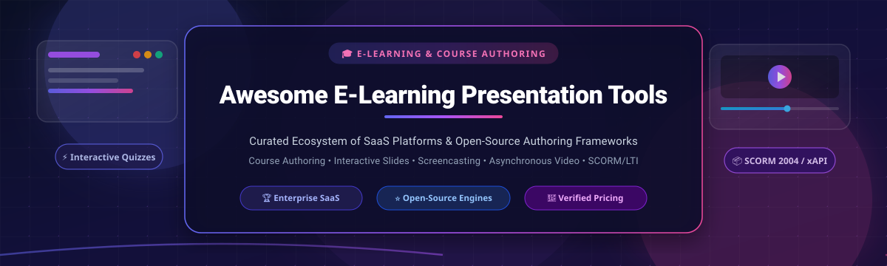
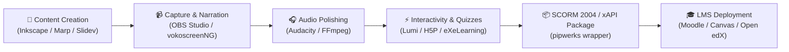

  

  
  
  
  
  
  
  

---

# 🎓 Awesome E-Learning Presentation Tools

> 🚀 **A curated directory of top SaaS platforms and open-source GitHub projects for interactive course authoring, slide-based learning, screencasting, asynchronous video training, and SCORM/xAPI LMS delivery.**

Welcome to the definitive repository for **E-Learning Presentation Tools**! Whether you are an instructional designer building SCORM-compliant enterprise compliance courses, a professor recording flipped-classroom lecture screencasts, or an engineer creating code-first web presentations, this guide provides verified pricing, free tier limits, company valuations, and sorted open-source alternatives.

---

## 📑 Table of Contents

- [📊 Sector Overview & Market Dynamics](#-sector-overview--market-dynamics)
- [🏢 SaaS & Hosted Platforms](#-saas--hosted-platforms)
- [💻 Open-Source GitHub Projects](#-open-source-github-projects)
- [🛠️ Additional Open-Source Multimedia Utilities](#️-additional-open-source-multimedia-utilities)
- [🧩 Architecture: Building a Sovereign E-Learning Pipeline](#-architecture-building-a-sovereign-e-learning-pipeline)
- [🤝 How to Contribute](#-how-to-contribute)
- [☕ Support & Community](#-support--community)
- [⭐ Star History](#-star-history)
- [📜 Disclaimer & Compliance](#-disclaimer--compliance)

---

## 📊 Sector Overview & Market Dynamics

The global **E-Learning Authoring and Interactive Presentation Software** market was valued at **$1.45 billion in 2024** and is projected to expand to **$3.25 billion by 2030**, advancing at a compound annual growth rate (**CAGR of 14.3%**). This acceleration is propelled by remote workforce onboarding, the standardization of microlearning, and the integration of generative AI for rapid slide-to-video transformations.

The sector exhibits **moderate fragmentation**:
- **Enterprise Course Authoring & Compliance (Concentrated / Winner-Take-Most):** High-stakes corporate compliance training and complex branching simulations remain heavily anchored to legacy heavyweight suites like *Articulate 360* and *Adobe Captivate/Presenter*, creating steep switching costs around established SCORM 1.2/2004, xAPI, and cmi5 pipelines.
- **Asynchronous Video & Interactive Presentation (Highly Fragmented):** Cloud-native screencasting (*Loom*, *Vidyard*), dynamic canvas presentations (*Prezi*), animated explainer studios (*Vyond*, *Powtoon*), and web-first open-source engines (*reveal.js*, *Slidev*, *OBS Studio*) compete fiercely across pedagogical niches, academic institutions, and modern developer communities.

---

## 🏢 SaaS & Hosted Platforms

The table below lists the category-defining commercial platforms for e-learning presentations and course authoring, **sorted in descending order by company valuation / market capitalization / revenue**.

| 🏢 Platform | 💼 Company Size & Valuation | 💰 Starting Tier Pricing | 🎁 Free Tier Limits & Free Trial | 🎯 Key Capabilities & LMS Standards |
| :--- | :--- | :--- | :--- | :--- |
| **[Adobe Presenter / Captivate](https://helpx.adobe.com/presenter/faq.chromeless.html)** | **~$180B Market Cap** *(NASDAQ: ADBE; ~$21.5B Annual Rev)* | **$33.99 / user / month** *(Annual plan, billed monthly)* | **30-day free trial** *(Full desktop features unlocked; watermark on exported courses; no permanent free plan)* | PowerPoint-to-eLearning conversion, VR walkthroughs, software simulations, responsive HTML5, SCORM 1.2/2004, AICC, xAPI |
| **[Loom](https://www.atlassian.com/software/loom)** | **~$45B Market Cap** *(Acquired by Atlassian for $975M; NASDAQ: TEAM)* | **$12.50 / creator / month** *(Business plan billed annually, or $15/mo billed monthly)* | **Free Forever plan** *(Up to 25 videos/creator limit, 5-minute max recording length, 720p resolution, 1 workspace)* | Instant screen and webcam recording, AI automatic title & transcription generator, viewer engagement analytics, team workspaces |
| **[Articulate Studio / 360](https://www.articulatesupport.com/article/Articulate-360-Using-the-Desktop-Authoring-Apps)** | **$3.75B Valuation** *($1.5B Series A funding; ~$300M+ ARR)* | **$1,149 / user / year** *(Personal Plan; or $1,499/user/year for Teams)* | **14-day free trial** *(Up to 10 team seats, full access to Storyline 360, Rise 360, Review 360, and AI trial credits; no permanent free plan)* | Industry-standard slide-based course authoring, Presenter 360, Quizmaker 360, Engage 360, Content Library 360, SCORM 1.2/2004, xAPI, cmi5 |
| **[Prezi Video](https://prezi.com/)** | **~$300M Valuation** *($72.8M total funding; ~$50M+ ARR)* | **$7.00 / user / month** *(Standard plan billed annually, or $15/mo billed monthly)* | **Free Forever Basic plan** *(Up to 5 shareable public presentations, 500MB cloud storage, 500 AI generation credits, web-only presentation mode)* | Infinite zoomable canvas, live webcam overlay during Zoom/Teams calls, non-linear storytelling, visual animations |
| **[Vidyard](https://www.vidyard.com/blog/what-is-vidyard/)** | **~$300M Valuation** *($70M+ total venture funding; ~$35M ARR)* | **$19.00 / user / month** *(Pro plan billed annually, or $29/mo billed monthly)* | **Free Forever plan** *(5 recorded videos/month, 15 lifetime AI avatar videos, 30-minute max recording length, basic share links)* | Asynchronous video messaging, AI avatars, automated email embedding, screen recording, CRM integrations (Salesforce, HubSpot) |
| **[Brainshark](https://help.bigtincan.com/hc/en-us/articles/38235445613074-Brainshark-Release-Notes)** | **~$200M Valuation** *($116M acquisition by Bigtincan; ~$80M Annual Rev)* | **~$83.00 / user / month** *(Pro tier estimate; billed annually ~$996/user/yr with typical 20-seat minimum)* | **14-day guided sandbox demo/pilot** *(Available upon enterprise sales consultation; no self-service public free tier)* | Video-based readiness & coaching, AI voice/speech analysis, pitch evaluation challenges, curriculum tracking, SCORM export |
| **[Camtasia](https://www.techsmith.com/camtasia/features/)** | **~$100M+ ARR** *(Backed by Marlin Equity Partners; 300+ employees)* | **$179.88 / user / year** *(Essentials plan; or $39/yr Starter; single-user license)* | **Uncapped duration free trial** *(Full Camtasia Editor editing tools unlocked; video exports carry a visible Camtasia watermark)* | Multi-track screen and audio recording, interactive in-video quizzes, cursor path effects, text-based audio editing, SCORM packaging |
| **[Vyond](https://www.vyond.com/)** | **~$60M ARR** *(Private; GoAnimate, Inc.; 120+ employees)* | **$99.00 / user / month** *(Starter plan; or $699/user/year billed annually)* | **14-day free trial** *(Create up to 3 watermarked videos, 720p in-app preview, no direct MP4 downloads/exports; no permanent free plan)* | Animated e-learning video creation, lip-syncing characters, AI prompt-to-video generation, 650+ voices, MP4/GIF export |
| **[Powtoon](https://www.powtoon.com/)** | **~$30M ARR** *(Private; VC-backed; 100+ employees)* | **$15.00 / month** *(Lite plan billed annually at $180/year, or $49 billed monthly)* | **Free Forever plan** *(3-minute max video length, Powtoon watermark, 100MB cloud storage, 720p quality, web/YouTube export only)* | Drag-and-drop animated slide decks, character customization, webcam/screen recording, microlearning LMS export |
| **[iSpring Presenter](https://www.ispringsolutions.com/ispring-presenter)** | **~$25M ARR** *(Bootstrapped & profitable; 200+ employees)* | **$570.00 / author / year** *(Single author annual subscription)* | **14-day free trial** *(Full software functionality enabled; published HTML5/SCORM content includes an evaluation watermark; no permanent free plan)* | Native PowerPoint add-in, 14 interactive quiz formats, audio/video narration synchronization, verified compatibility with 150+ LMSs (SCORM 1.2/2004, xAPI, cmi5) |

---

## 💻 Open-Source GitHub Projects

The following open-source e-learning presentation frameworks, screencasting tools, and lecture-recording suites are **sorted in descending order by GitHub Star counts**. Each entry includes an official social star badge linked directly to its stargazers page.

### 1. [Manim](https://github.com/3b1b/manim) 
- **Primary Focus:** Programmatic Mathematical & Explanatory Animation Engine
- **License:** MIT
- **Tech Stack:** Python, Cairo / OpenGL, FFmpeg
- **Description:** Originally created by Grant Sanderson (3Blue1Brown), Manim is an open-source animation engine designed for creating precise, programmatic explanatory videos and animations for science and mathematics education. It enables developers and educators to write Python code that renders mathematical formulas, vector fields, and pedagogical diagrams into high-definition video presentations.

### 2. [OBS Studio](https://github.com/obsproject/obs-studio) 
- **Primary Focus:** High-Performance Screen Recording & Lecture Streaming
- **License:** GPL-2.0
- **Tech Stack:** C, C++, Qt
- **Description:** The industry-standard open-source screencasting and live production software. Ideal for educators, trainers, and instructional designers recording multi-source lectures with webcam picture-in-picture, slide overlays, hardware capture cards, custom scenes, audio filters (noise gates, VST plugins), and ultra-low latency hardware-accelerated video encoding.

### 3. [reveal.js](https://github.com/hakimel/reveal.js) 
- **Primary Focus:** Web-Based HTML5 Presentation Framework
- **License:** MIT
- **Tech Stack:** JavaScript, HTML5, CSS3
- **Description:** The premier open-source HTML presentation framework. Enables developers and educators to build responsive, interactive slide decks using Markdown, nested 2D slide layouts (vertical slides for sub-topics), LaTeX formulas (MathJax/KaTeX), code syntax highlighting, speaker notes window, PDF export, and seamless iframe integration for live quizzes and e-learning widgets.

### 4. [Slidev](https://github.com/slidevjs/slidev) 
- **Primary Focus:** Presentation Slides for Developers & Technical Educators
- **License:** MIT
- **Tech Stack:** Vue.js, Vite, TypeScript, Markdown
- **Description:** Presentation slides built from pure Markdown with embedded Vue components. Features instant hot-module reloading, interactive code runners, integrated Monaco editor, presentation recording with webcam overlay, drawing annotations, presenter view, and single-click export to PDF, PNG, or self-hosted SPA web presentations.

### 5. [impress.js](https://github.com/impress/impress.js) 
- **Primary Focus:** 3D Infinite Canvas Presentation Engine (Open-Source Prezi Alternative)
- **License:** MIT / Apache-2.0
- **Tech Stack:** JavaScript, CSS3 3D Transforms
- **Description:** An open-source presentation framework inspired by Prezi. Uses CSS3 3D transforms, rotations, and infinite-plane translations in modern browsers to deliver non-linear, visually cinematic presentations that break free from traditional linear slide sequences.

### 6. [asciinema](https://github.com/asciinema/asciinema) 
- **Primary Focus:** Lightweight Terminal Session Screencasting & Interactive Replay
- **License:** GPL-3.0
- **Tech Stack:** Rust / Python
- **Description:** Terminal session recorder that captures purely text-based command-line interactions. Unlike heavy video screencasts, asciinema recordings are lightweight JSON-based files where students and viewers can pause the lecture, highlight text, and copy-paste code commands directly out of the video player.

### 7. [Xournal++](https://github.com/Xournalpp/xournalpp) 
- **Primary Focus:** Hand-Drawn Lecture Notetaking & PDF Presentation Annotation
- **License:** GPL-2.0
- **Tech Stack:** C++, GTK3
- **Description:** Open-source handwriting notetaking and lecture-delivery tool supporting pressure-sensitive graphic tablets (Wacom, Huion). Teachers use it to annotate slide decks and PDF textbooks in real time, draw geometrical shapes, render LaTeX equations on-the-fly, and record synchronized audio lectures.

### 8. [Marp](https://github.com/marp-team/marp) 
- **Primary Focus:** Markdown-to-Presentation Ecosystem
- **License:** MIT
- **Tech Stack:** TypeScript, CSS, Node.js
- **Description:** The Markdown Presentation Ecosystem. Writes clean, standardized Markdown and instantly outputs professional slide decks via Marp CLI or the popular VS Code extension. Converts directly to HTML5 presentation slides, PDF handouts, and PowerPoint (PPTX) presentations with custom CSS themes.

### 9. [BigBlueButton](https://github.com/bigbluebutton/bigbluebutton) 
- **Primary Focus:** Sovereign Virtual Classroom & Lecture Presentation Web System
- **License:** LGPL-3.0
- **Tech Stack:** Scala, Java, JavaScript, WebRTC
- **Description:** Purpose-built open-source web conferencing and virtual classroom system designed for educators. Includes synchronized slide presentation broadcasting, multi-user shared whiteboards, real-time student polling, breakout rooms, webcam feeds, and native LTI/Moodle/Canvas LMS integration.

### 10. [Shower](https://github.com/shower/shower) 
- **Primary Focus:** Minimalist HTML5 Slide Presentation Engine
- **License:** MIT
- **Tech Stack:** HTML5, CSS3, JavaScript
- **Description:** Light, modular, responsive HTML presentation engine. Features an intuitive two-mode interface: a slide grid overview ("ribbon mode") for fast browsing and full-screen presenter display for lecturing with touch and keyboard controls.

### 11. [LibreOffice Impress](https://github.com/LibreOffice/core) 
- **Primary Focus:** Full-Featured Desktop Slide Presentation Suite
- **License:** MPL-2.0
- **Tech Stack:** C++, Java, Python
- **Description:** The gold standard open-source desktop office presentation tool. Provides 2D/3D animations, slide transitions, presenter console with speaker notes and timers, comprehensive media embedding, and bidirectional export/import support for PPTX, ODP, PDF, and HTML slide decks.

### 12. [DeckCraft](https://github.com/storytold/deckcraft) 
- **Primary Focus:** Modern Clean-Room Rust PowerPoint Engine & AI Agent Tooling
- **License:** MIT / Apache-2.0
- **Tech Stack:** Rust
- **Description:** A clean-room reimplementation of PowerPoint in pure Rust. Built for performance, developer-first presentation generation, headless rendering, and direct MCP (Model Context Protocol) automation for AI agent workflows.

### 13. [OpenBoard](https://github.com/OpenBoard-org/OpenBoard) 
- **Primary Focus:** Interactive Digital Whiteboard for Schools and Universities
- **License:** GPL-3.0
- **Tech Stack:** C++, Qt5
- **Description:** Open-source interactive whiteboard application specifically designed for academic environments. Supports dual-screen teaching setups, drawing over desktop applications and browser pages, PDF/document imports, virtual educational widgets (rulers, compasses), and one-click lecture podcast screencasting.

### 14. [Sozi](https://github.com/sozi-projects/Sozi) 
- **Primary Focus:** SVG-Based Zooming Presentation Editor
- **License:** GPL-3.0
- **Tech Stack:** JavaScript, Electron, SVG
- **Description:** A zooming presentation editor that turns standard SVG vector drawings (created in Inkscape or Illustrator) into animated, non-linear web presentations. Presenters define camera frames on the infinite SVG canvas, and Sozi smoothly animates pan, zoom, and rotation between key concepts.

### 15. [vokoscreenNG](https://github.com/vkohaupt/vokoscreenNG) 
- **Primary Focus:** Desktop Lecture Screencaster & Audio Recorder
- **License:** GPL-2.0
- **Tech Stack:** C++, Qt, GStreamer
- **Description:** A user-friendly open-source screencast creator for desktop educational videos, tutorials, and recorded lectures. Captures full screens, single windows, or defined areas alongside webcam video feeds, click highlights, magnifier lenses, and multi-source audio in MP4, MKV, and WebM.

### 16. [FreeShow](https://github.com/ChurchApps/FreeShow) 
- **Primary Focus:** Multi-Screen Presentation & Stage Display Software
- **License:** GPL-3.0
- **Tech Stack:** Electron, TypeScript, React
- **Description:** Modern, cross-platform presentation software designed for live events, auditoriums, and classrooms. Supports multi-output feeds (audience view, stage prompter display, presenter notes), media playback, lyrics/slide formatting, and mobile remote control.

### 17. [Lumi (H5P Desktop Editor)](https://github.com/Lumieducation/Lumi) 
- **Primary Focus:** Desktop Authoring for H5P Interactive Learning & Course Presentations
- **License:** AGPL-3.0
- **Tech Stack:** TypeScript, Electron, Node.js
- **Description:** Desktop authoring application that allows educators to create, edit, and view HTML5 interactive learning content (including Course Presentations, Interactive Videos, Branching Scenarios, and Quizzes) offline on Windows, macOS, and Linux without requiring a live Moodle or WordPress LMS server. Exports directly to standalone HTML and SCORM packages.

### 18. [eXeLearning](https://github.com/exelearning/exelearning) 
- **Primary Focus:** AGPL E-Learning Course Authoring with SCORM Packaging
- **License:** AGPL-3.0
- **Tech Stack:** Python, JavaScript, Docker
- **Description:** Open-source authoring tool specifically designed to help teachers and academics create structured educational resources. Features modular pedagogical "iDevices" (quizzes, reading exercises, cloze activities, image galleries), real-time team collaboration via Yjs, Docker deployment, and native export to SCORM 1.2, SCORM 2004, IMS Content Packaging, and web packages.

---

## 🛠️ Additional Open-Source Multimedia Utilities

These foundational open-source utilities empower developers and creators to process, package, and refine e-learning content pipelines:

- **[FFmpeg](https://github.com/FFmpeg/FFmpeg)** — The industry-standard multimedia framework for recording, transcoding, cutting, and optimizing instructional video screencasts.
- **[Audacity](https://github.com/audacity/audacity)** — Open-source multi-track audio editor for cleaning up lecture voiceovers, removing background microphone hum, and normalizing narration audio.
- **[Inkscape](https://gitlab.com/inkscape/inkscape)** — Professional vector graphics editor used to illustrate custom diagrams, iconography, and multi-layered slide canvases for Sozi and web presentations.
- **[scorm-api-wrapper](https://github.com/pipwerks/scorm-api-wrapper)** — Clean JavaScript wrapper simplifying bidirectional communication between HTML5 web presentations and SCORM 1.2 / 2004 LMS environments.

---

## 🧩 Architecture: Building a Sovereign E-Learning Pipeline

Organizations seeking to avoid steep per-seat SaaS subscription costs can assemble a powerful, self-hosted, sovereign e-learning pipeline:

---

## 🤝 How to Contribute

Contributions are warmly welcome! Help make this ecosystem resource even better:

1. **Fork** the repository to your own GitHub account.
2. **Add or update** entries in [README.md](README.md) following the existing Markdown formatting.
3. **Verify criteria**:
   - For **SaaS products**: Provide verified starting tier pricing, specific free trial/plan limits, and company valuation/revenue context.
   - For **Open-Source projects**: Ensure the repository is active and has an official GitHub star badge linking to its `/stargazers` page.
4. **Submit a Pull Request** with a concise summary of your addition.

---

## ☕ Support & Community

Thank you for exploring and using this repository! If this curated collection helps your teaching, instructional design, or software projects:

- ⭐ **Star this repository** to help other educators and engineers discover it!
- 🍴 **Fork and share** with your L&D team, colleagues, or classroom.
- 💬 **Join our community discussion** on [Discord](https://discord.gg/jc4xtF58Ve) or follow updates via [GitHub](https://github.com/ishandutta2007).
- ☕ **Support future open-source curation** by buying a coffee via our [GitHub Sponsor Dashboard](https://github.com/sponsors/ishandutta2007).

---

## ⭐ Star History

---

## 📜 Disclaimer & Compliance

- **Community-Curated Resource:** This repository is an independent, community-driven resource and is not officially affiliated with or endorsed by any listed company or product.
- **Accessibility & Inclusion:** All educational and e-learning presentation materials should be designed in compliance with **WCAG 2.1 AA** and **Section 508** standards (including closed captions, contrast ratios, and keyboard navigability).
- **Licensing Compliance:** Review each open-source repository's license terms before deploying in commercial enterprise contexts (e.g., AGPL-3.0 reciprocal distribution obligations).
